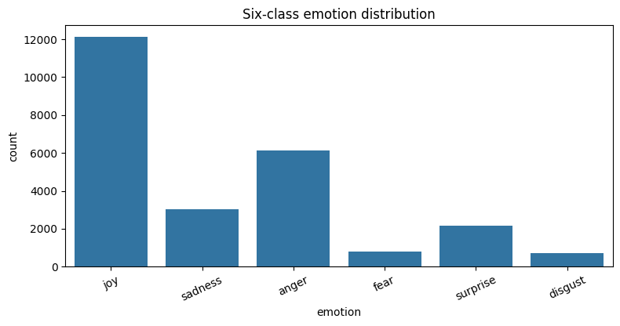
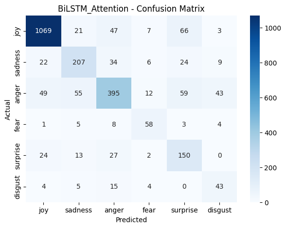
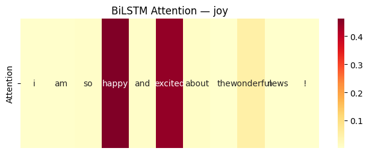

# Emotion Classification with Attention

Classifies short English text into six emotions: joy, sadness, anger, fear, surprise and disgust. It compares LSTM, GRU, BiLSTM with attention and DistilBERT, shows which words the attention layer focuses on, and includes a Gradio app.

## Dataset

[GoEmotions](https://www.kaggle.com/datasets/debarshichanda/goemotions): 54,263 Reddit comments with 28 labels.

- Related labels were grouped into six emotions
- Comments that mapped to none, or to more than one, of the six were dropped, leaving **24,939 comments**
- Classes are imbalanced: 12,127 joy against 708 disgust



## Results

| Model | Test set | Accuracy | Macro F1 |
|---|---|---|---|
| LSTM + GloVe | random split (2,494) | 76.3% | 0.655 |
| GRU + GloVe | random split (2,494) | 77.2% | 0.661 |
| BiLSTM + Attention + GloVe | random split (2,494) | 77.1% | 0.673 |
| **DistilBERT** | official split (2,499) | **81.7%** | **0.725** |

> The recurrent models use a random 80/10/10 split and DistilBERT uses the official GoEmotions split, so the test sets differ. Treat the gap between them as approximate.

DistilBERT per class:

| Emotion | Precision | Recall | F1 |
|---|---|---|---|
| joy | 0.90 | 0.95 | 0.93 |
| anger | 0.80 | 0.75 | 0.77 |
| fear | 0.75 | 0.74 | 0.75 |
| sadness | 0.74 | 0.65 | 0.69 |
| surprise | 0.59 | 0.66 | 0.62 |
| disgust | 0.64 | 0.54 | 0.58 |



## Attention

For "I am so happy and excited about the wonderful news!", the BiLSTM predicts joy and puts most of its attention on *happy* and *excited*.



## Approach

- **Recurrent models:** 100d GloVe embeddings (97.6% vocabulary coverage), 128 hidden units, class-weighted loss, gradient clipping, 5 epochs, best epoch chosen by validation macro F1
- **Attention:** a learned score per time step, with padding masked, then a weighted sum of BiLSTM outputs
- **DistilBERT:** `distilbert-base-uncased`, 3 epochs, learning rate 2e-5, best epoch was the first

## Limitations

- Disgust and surprise are the weakest DistilBERT classes.
- The Gradio app has no emoji or description for disgust and shows a default one instead.

## Demo

[demo/demo.mp4](demo/demo.mp4)

## Run it

1. Open [the notebook](notebooks/emotion-classification-with-attention.ipynb) on Kaggle with a GPU and internet enabled.
2. Attach the dataset above and check that `DATA_DIR` matches.
3. Run the cells in order. The Gradio app is the last code cell.

To work locally, run `pip install -r requirements.txt` and change the `/kaggle/...` paths. Trained weights are not included.

## Structure

```
├── notebooks/emotion-classification-with-attention.ipynb
├── assets/
├── demo/demo.mp4
├── requirements.txt
└── README.md
```
